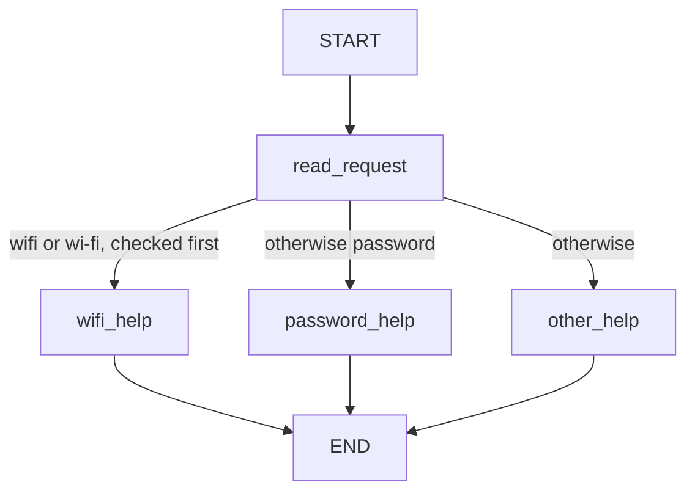
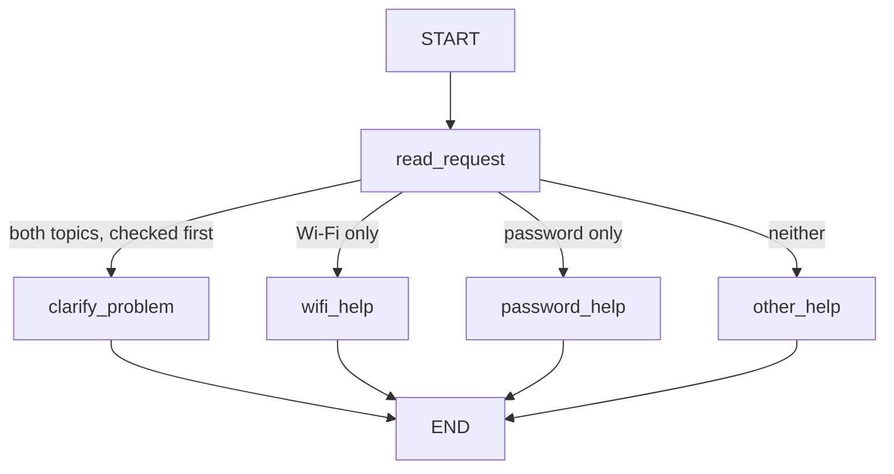
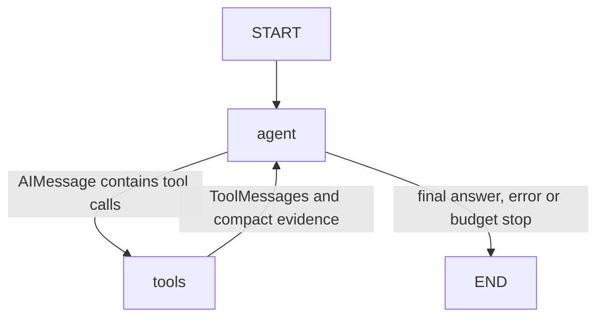

# HW5 — My LangGraph helpdesk

## Part 1 — How the graph works

### My graph and state

The **Original / Initial Version** is compiled by `build_original_graph()` in `src/helpdesk/graphs.py`:

The state schema is `HelpdeskState`: `message` holds the original text, `category` holds the classification, and `reply` holds the answer. Each execution starts with an empty category and reply.

| Node | Reads | Returns as a partial update |
| --- | --- | --- |
| `read_request` | `message`, matched case-insensitively using `casefold()` | `category`: `wifi`, `password`, or `other` in Original |
| `wifi_help` | `category` and the Wi-Fi entry in `data/helpdesk.json` | `reply`: guide title, identifier and all numbered steps |
| `password_help` | `category` and the password entry in `data/helpdesk.json` | `reply`: guide title, identifier and all numbered steps |
| `other_help` | No state field is needed for this fixed question | `reply`: asks whether the problem concerns Wi-Fi or a password |

The two instruction nodes share a Python implementation but are separate registered LangGraph nodes. The guide is loaded from the JSON file during execution; its troubleshooting steps are not embedded in the code.

**1. What does each node read and change?** The table specifies the original nodes. No node overwrites `message`; response nodes preserve `category`. In Main, `read_request` may additionally return `category="both"`; the new `clarify_problem` node needs no state fields and updates only `reply` with a question about which problem to solve first.

**2. State update versus conditional routing.** A node returns a dictionary of changed state fields. LangGraph merges that update into the current state using the schema's default replacement behavior for those fields. The conditional function `choose_route` reads the resulting `category` and returns a destination name. It does not change state. Python keyword checks therefore occur inside a real LangGraph node; the conditional edge schedules the help node.

**3. What does the next node receive?** It receives the complete current graph state, including unchanged fields, rather than just the last update. For example, the S01 update from `read_request` contains only `category`, but the corresponding streamed state still contains the exact original message and empty reply. After `wifi_help`, that same message and category remain while the reply is filled. Tests compare these streamed states with `graph.invoke()` results.

**4. START, END and compilation.** `START` is the graph's entry sentinel and `END` marks termination; neither executes a Python help function. `compile()` validates the configured graph structure and creates the runnable graph used by `invoke()` or `stream()`. Both versions are compiled independently, without a checkpointer or persistent store in Part 1. These semantics follow the official [Graph API documentation](https://docs.langchain.com/oss/python/langgraph/graph-api).

### Predictions before running

| Message | Predicted route | Actual route | What I learned |
| --- | --- | --- | --- |
| I cannot connect to Wi-Fi. | START → read_request → wifi_help → END | START → read_request → wifi_help → END | S01 matched: `wi-fi` selects the JSON Wi-Fi guide. [Log](outputs/part1/original/S01.json). |
| I forgot my PASSWORD. | START → read_request → password_help → END | START → read_request → password_help → END | S02 matched: uppercase PASSWORD matches after case folding. [Log](outputs/part1/original/S02.json). |
| My laptop screen is broken. | START → read_request → other_help → END | START → read_request → other_help → END | S03 matched: neither keyword occurs, so the graph asks which supported topic applies. [Log](outputs/part1/original/S03.json). |
| My Wi-Fi password does not work. | START → read_request → wifi_help → END | START → read_request → wifi_help → END | S04 matched: the first Wi-Fi rule has priority over password. [Log](outputs/part1/original/S04.json). |

Predictions for S01–S05 were written in [PREDICTIONS.md](outputs/part1/PREDICTIONS.md) before implementing or executing the graphs. The table above reports the subsequent actual Original runs. START/END are drawn as boundaries; each JSON log lists only executed Python nodes. Logs pair the real `updates` stream with complete `values` snapshots from the same execution, using LangGraph's [streaming API](https://docs.langchain.com/oss/python/langgraph/streaming).

### My change to the graph

The **Improved / Main Version**, compiled by `build_main_graph()`, is the default for message input:

`clarify_problem` is the additional node. Original remains separately executable and does not contain it. Both versions reuse the instruction nodes, unsupported-topic question, state schema and conditional-edge function.

S04 and S05 use the identical fixture input, `My Wi-Fi password does not work.` The measured traces show:

| Run | First node and update | Next node and update | Final behavior |
| --- | --- | --- | --- |
| [S04, Original](outputs/part1/original/S04.json) | `read_request`: `{"category": "wifi"}` | `wifi_help`: `reply` containing GUIDE-WIFI and its steps | Returns Wi-Fi instructions because the original classifier checks Wi-Fi before password. |
| [S05, Main](outputs/part1/improved/S05.json) | `read_request`: `{"category": "both"}` | `clarify_problem`: `{"reply": "Which problem would you like to solve first: Wi-Fi connectivity or password recovery?"}` | Asks which issue to solve first; no instruction node executes. |

S05's predicted and actual route both were START → read_request → clarify_problem → END. In both logs the full state after the first node retains the original message and an empty reply; after the second node only the reply changes. The tests also execute Wi-Fi-only, password-only and unsupported messages on Main and confirm unchanged behavior.

LangGraph controls node scheduling, state propagation, conditional-edge traversal, termination and stream delivery. My Python functions decide which keywords match, which category to return, which destination corresponds to that category, and how to format the retrieved guide or clarification question. There is no model decision in Part 1: fixed rules and local reference data are sufficient. The tests run without API keys and block provider imports and network connections in a fresh interpreter. No model mock is necessary.

## Part 2 — Model and tools

### Architecture and execution status

Part 2 adds one explicit LangGraph agent using `ChatOpenAI` from `langchain-openai`. There are no supervisor, classifier or delegated agents. Both deterministic Part 1 graphs remain unchanged. The provider is **OpenAI**, with the tool-capable model supplied through `MODEL_NAME`; no model identifier is assumed to be available.

**Live verification is complete for S06–S09 and S14.** The configured model was `gpt-5-mini`; the API reported the exact model identifier `gpt-5-mini-2025-08-07`. [LIVE_STATUS.json](outputs/part2/LIVE_STATUS.json) records validated actual executions, draft paths and measured usage. The five final accepted traces contain **16 model calls and 11 tool executions**, using **12,384 input tokens and 6,832 output tokens (19,216 total)**. Output usage includes the API's reported reasoning tokens. Earlier S08/S09 attempts are retained separately and excluded from those totals. The labelled fake-model examples below remain separate from the live evidence.

The `tools` node is the standard LangGraph `ToolNode`, not a custom concurrency framework. OpenAI tool binding enables parallel requests. Independent reads can run together; dependent ticket writes require completed evidence from an earlier tools step.

### Answers to the four questions

**1. How does the graph choose tools or termination?** After the `agent` node returns, a conditional edge inspects the last AIMessage's `tool_calls`. Nonempty calls select `tools`; an answer without calls selects END. The agent checks invocation budgets before another model request. Rejected oversized batches receive matching error ToolMessages and terminate without executing that batch.

**2. Who requests and who executes a tool?** In production the configured OpenAI model requests a tool name, arguments and call ID. `ToolNode` invokes the corresponding local Python adapter. The model cannot execute filesystem operations itself or choose the active snapshot. Offline tests substitute a clearly labelled tool-calling fake while retaining the real graph, reducers and local tool implementations.

**3. What changes after a result returns?** `messages` appends a ToolMessage with the original `tool_call_id` through `add_messages`. `tool_results` merges concise structured evidence by that same ID. Each tool wrapper returns `Command(update=...)` for these two channels, so simultaneous results are preserved. The full guide remains in the ToolMessage; evidence keeps its topic and reference ID rather than duplicating its steps. On returning to `agent`, one controlled updater replaces the complete nested `helpdesk` and `control` dictionaries, preserving their required fields explicitly. LangGraph does not automatically deep-merge those dictionaries.

**4. How is this different from Part 1?** Part 1 maps keywords to a fixed help node. Part 2 lets one language model select zero, one or several tools, inspect their returned data and request further tools before answering. Python still enforces input validity, trusted identity/snapshot selection, ticket permission and execution limits. The fake tests verify these mechanisms but cannot establish the quality of real model decisions.

### State, context and ticket validation

The shared `HelpdeskAgentState` contains four root channels:

| Channel | Contents and update rule |
| --- | --- |
| `messages` | System, human, AI and tool messages; `add_messages` preserves conversation order and message identity. |
| `tool_results` | Call-ID-keyed compact tool evidence, execution outcome and user-turn number; `merge_results` combines independent calls and rejects conflicting reuse of an ID. |
| `helpdesk` | Current category, problem description, exact user-reported troubleshooting spans, whether steps are known, ticket request/condition, draft ID and credential flag; centrally replaced. |
| `control` | Per-turn model calls, successful tool completions, all dispatch attempts, limit flag, stop reason and diagnostics; centrally replaced. |

Frozen runtime context supplies `user_id`, `thread_id`, `status_profile`, storage directory and run identity. These fields are absent from model-facing tool schemas. The model sees only relevant conversation and tool messages, not the root State or private runtime configuration. Context lasts within one process; no Part 3 checkpointer or preference store has been added.

The write boundary derives permission and details from original HumanMessages rather than model arguments. The model-facing `prepare_ticket` accepts no user-controlled fields. It asks for missing descriptions or steps, rejects ambiguous conditions, clears old issue details when topics change, and includes only reported troubleshooting spans. Explicitly reporting no steps is permitted. Recognizable credentials are redacted before model input/logging and block ticket creation.

For an operational-only request, the matching service must have a completed operational result in the current user turn and active snapshot. Outage, unknown, not checked, the wrong service, an earlier turn and a same-batch lookup cannot authorize a write. An unconditional ticket can instead record `not_checked`. The fixture template supplies the JSON shape; IDs are generated, application identity is used, and files are local drafts only. A stable run/call identity and exclusive file creation prevent duplicate same-call retries.

### Measured live demonstrations

The live runs use the same `run_scenario` function as the CLI; the logs identify the direct Python invocation and record the equivalent CLI replay with its storage-directory argument. All scenario messages and selected profiles come unchanged from the fixtures. Each scenario starts with fresh state; both messages of S06/S09 share one in-process session.

| Scenario | Actual live result | Model calls / tools | Total tokens |
| --- | --- | --- | --- |
| [S06](outputs/part2/S06.json) | Retrieved GUIDE-WIFI; completed an operational Wi-Fi check, then created a local draft in a later tools step. The file contains exactly the user's reported steps and the guide reference. | 5 / 3 | 5,042 |
| [S07](outputs/part2/S07.json) | Reported the fictional Wi-Fi outage and no supplied repair time; no conditional draft was created. | 3 / 2 | 4,235 |
| [S08](outputs/part2/S08.json) | Parallel guide/status reads returned unknown. No draft was created; the assistant offered retrying or explicitly requesting an unconditional draft. | 2 / 2 | 2,828 |
| [S09](outputs/part2/S09.json) | First asked for the issue and steps with no tool/write. After the supplied clarification, read guide/status in parallel, then created the draft. Its recorded status is operational. | 4 / 3 | 5,051 |
| [S14](outputs/part2/S14.json) | Checked account_recovery in recovery_outage, reported outage and no supplied repair time. No Wi-Fi lookup or ticket was performed. | 2 / 1 | 2,060 |

`python -m tests.verify_live_evidence` verifies the saved tool-call/response IDs, successful termination, usage counts, actual draft files, template fields, reported steps and causal ordering. S06's ticket is created only after the operational status result has been committed in an earlier tools step. S08/S09 demonstrate actual multiple-tool responses, complementing the offline concurrency-barrier test.

The [initial S09 run](outputs/part2/initial/S09.json) failed the expected second-turn draft behavior: the model incorrectly required contact/device/location details that the template does not need. The prompt was corrected to specify the exact required information and preserve the earlier ticket request without another confirmation. The [initial S08 run](outputs/part2/initial/S08.json) honored the condition but described the operational requirement too broadly; the prompt now explicitly permits unconditional drafts without operational status. Both scenarios were rerun successfully, with their accepted traces linked above. These initial attempts are retained as genuine debugging evidence rather than presented as passing results.

### Measured offline demonstrations

Run `python -m tests.record_part2` after the README setup to repeat direct calls and clearly labelled offline graph scenarios. [direct_tools.json](outputs/part2/fake/direct_tools.json) records actual direct calls to `find_instructions` for both topics, `check_service_status` for both services in all four profiles, and `prepare_ticket` with fictional user-reported details. The corresponding JSON draft exists at the returned path. Password maps to `account_recovery`; missing status data remains unknown.

| Scenario | Actual fake-model graph behavior | Model calls / completed tools |
| --- | --- | --- |
| [S06](outputs/part2/fake/S06.json) | Turn 1 retrieves GUIDE-WIFI. Turn 2 reads instructions/status in parallel, receives operational Wi-Fi status, then creates a local draft in a later tools step. | 5 / 4 across two turns |
| [S07](outputs/part2/fake/S07.json) | Parallel guide/status reads return the Wi-Fi outage; no ticket is created. No repair time is invented. | 2 / 2 |
| [S08](outputs/part2/fake/S08.json) | Status is unknown; no conditional draft is created, and the response offers a next step. | 2 / 2 |
| [S09](outputs/part2/fake/S09.json) | First turn asks for problem/steps without writing. The next turn uses the reported Wi-Fi details and saves an unconditional draft marked not_checked. | 3 / 1 across two turns |
| [S14](outputs/part2/fake/S14.json) | Checks account_recovery in recovery_outage and reports its fictional outage. No ticket or restoration time is invented. | 2 / 2 |

S06's actual node order is `agent → tools → agent` in turn 1 and `agent → tools → agent → tools → agent` in turn 2. The two independent reads share a tool batch and have distinct IDs/messages; the ticket appears in the next batch. Logs contain streamed node updates, relevant post-step state, actual tool requests/results and final replies. A separate barrier-based test verifies simultaneous execution rather than only issuing two requests. Another test requests status and ticket together: the premature write is rejected as not_checked, and a later call can succeed after the status result is committed.

### Limits, errors and remaining verification

Defaults allow six model invocations and five tool dispatch attempts per user turn, counting failed dispatches against the budget. Successful completions are recorded separately. The entire proposed batch is checked before execution. The recursion limit is 16 (`2 * max_model_calls + 4`), above the maximum controlled loop length. Tool exceptions become safe ToolMessages; model failures retain only an error class. Malformed protocol output is captured in diagnostics outside future model history. Budget termination resolves all admitted calls before returning a final diagnostic answer.

All **98 tests pass**, including the 27 Part 1 tests. They cover direct tools, real graph transitions, concurrent evidence merging, causal write guards, multi-turn scenarios, input/protocol errors, limits, Responses API display handling and UTF-8 CLI output. See [VERIFICATION.md](outputs/part2/VERIFICATION.md). Usage is captured from actual AIMessage metadata; offline scenario models emit no measured token usage. Encrypted reasoning/protocol blocks are retained only in the running model history when needed and omitted from logs and final display. Remaining limitations are conservative English intent extraction, heuristic credential detection, probabilistic model wording and no persistent memory. All required Part 2 live demonstrations now have verified execution evidence.

## Part 3 — Memory

TODO: explain conversation state, thread_id, user identifier, user preference storage, and retrieval from helpdesk.json.

| Situation | Command used | Log file | What happened |
| --- | --- | --- | --- |
| Refer to an earlier message | | | |
| Close, restart and resume | | | |
| Same user, new conversation | | | |
| Different user | | | |

## Part 4 — Running and checking my work

TODO: point to the README setup steps, package versions, memory-reset instructions, tests and GitHub Actions workflow. Explain which mistake each test catches and which runs use a fake model.

## Choices and limitations

TODO: explain the storage and libraries I chose, why they fit this task, and what still does not work reliably.

## Supplied scenarios — my actual results

| Scenario | Command or manual steps | Log file | What happened / what I changed |
| --- | --- | --- | --- |
| S01 — Simple Wi-Fi route | `python -m helpdesk.cli --scenario S01` | [S01.json](outputs/part1/original/S01.json) | Original: read_request → wifi_help; returned GUIDE-WIFI from the fixture. Met expectation; prediction matched. |
| S02 — Case-insensitive password route | `python -m helpdesk.cli --scenario S02` | [S02.json](outputs/part1/original/S02.json) | Original: read_request → password_help; uppercase PASSWORD returned GUIDE-PASSWORD. Met expectation; prediction matched. |
| S03 — Unsupported request | `python -m helpdesk.cli --scenario S03` | [S03.json](outputs/part1/original/S03.json) | Original: read_request → other_help; asked whether the issue concerns Wi-Fi or a password. Met expectation; prediction matched. |
| S04 — Two topics before the graph change | `python -m helpdesk.cli --scenario S04` | [S04.json](outputs/part1/original/S04.json) | Original: read_request → wifi_help; Wi-Fi took priority. Met expectation; prediction matched. |
| S05 — Two topics after adding clarification | `python -m helpdesk.cli --scenario S05` | [S05.json](outputs/part1/improved/S05.json) | Improved / Main: read_request → clarify_problem; asked which problem to solve first. Met expectation; prediction matched. |
| S06 — Instructions then local ticket | `python -m helpdesk.cli --scenario S06 --storage-dir outputs/part2/live_drafts/S06` | [Live S06](outputs/part2/S06.json) | Met expectation: guide retrieved, Wi-Fi confirmed operational, then a real local draft saved with reported steps and reference ID. |
| S07 — The same request during a Wi-Fi outage | `python -m helpdesk.cli --scenario S07 --storage-dir outputs/part2/live_drafts/S07` | [Live S07](outputs/part2/S07.json) | Met expectation: fictional Wi-Fi outage, no conditional draft, no invented repair time. |
| S08 — Status source unavailable | `python -m helpdesk.cli --scenario S08 --storage-dir outputs/part2/live_drafts/S08` | [Live S08](outputs/part2/S08.json) | Met expectation after prompt clarification: unknown status, no conditional draft, appropriate next-step offer. Initial trace retained separately. |
| S09 — Missing ticket details | `python -m helpdesk.cli --scenario S09 --storage-dir outputs/part2/live_drafts/S09` | [Live S09](outputs/part2/S09.json) | Met expectation after correcting unnecessary detail requests: clarification first, then a real draft with reported steps and checked operational status. Initial failing trace retained separately. |
| S10 — Use the current conversation | | | |
| S11 — Persist and recall after restart | | | |
| S12 — Preference across threads without replay | | | |
| S13 — Do not share memory between users | | | |
| S14 — Password recovery outage | `python -m helpdesk.cli --scenario S14 --storage-dir outputs/part2/live_drafts/S14` | [Live S14](outputs/part2/S14.json) | Met expectation: checked account_recovery rather than Wi-Fi, reported fixture outage, no invented restoration time. |
