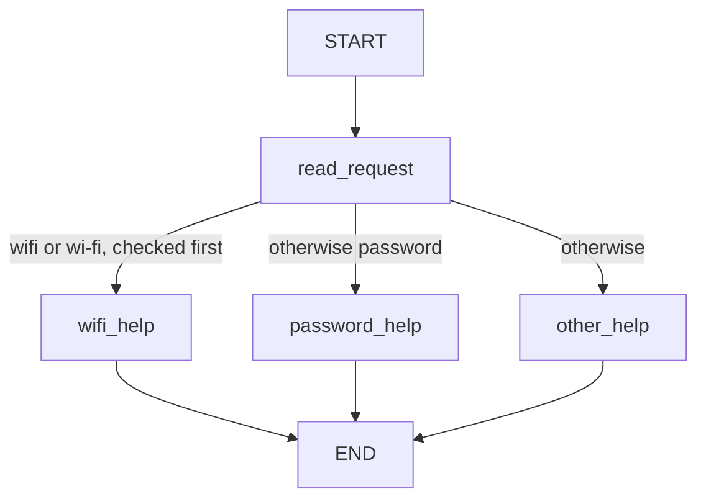
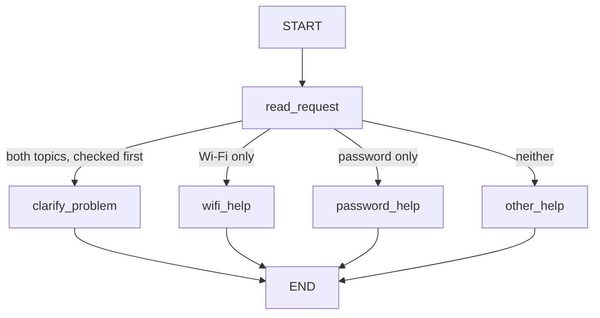

# HW5 — My LangGraph helpdesk

## Part 1 — How the graph works

### My graph and state

The **Original / Initial Version** is compiled by `build_original_graph()` in `src/helpdesk/graphs.py`:

The state schema is `HelpdeskState`: `message` holds the original text, `category` holds the classification, and `reply` holds the answer. Each execution starts with an empty category and reply.

| Node | Reads | Returns as a partial update |
| --- | --- | --- |
| `read_request` | `message`, matched case-insensitively using `casefold()` | `category`: `wifi`, `password`, or `other` in Original |
| `wifi_help` | `category` and the Wi-Fi entry in `data/helpdesk.json` | `reply`: guide title, identifier and all numbered steps |
| `password_help` | `category` and the password entry in `data/helpdesk.json` | `reply`: guide title, identifier and all numbered steps |
| `other_help` | No state field is needed for this fixed question | `reply`: asks whether the problem concerns Wi-Fi or a password |

The two instruction nodes share a Python implementation but are separate registered LangGraph nodes. The guide is loaded from the JSON file during execution; its troubleshooting steps are not embedded in the code.

**1. What does each node read and change?** The table specifies the original nodes. No node overwrites `message`; response nodes preserve `category`. In Main, `read_request` may additionally return `category="both"`; the new `clarify_problem` node needs no state fields and updates only `reply` with a question about which problem to solve first.

**2. State update versus conditional routing.** A node returns a dictionary of changed state fields. LangGraph merges that update into the current state using the schema's default replacement behavior for those fields. The conditional function `choose_route` reads the resulting `category` and returns a destination name. It does not change state. Python keyword checks therefore occur inside a real LangGraph node; the conditional edge schedules the help node.

**3. What does the next node receive?** It receives the complete current graph state, including unchanged fields, rather than just the last update. For example, the S01 update from `read_request` contains only `category`, but the corresponding streamed state still contains the exact original message and empty reply. After `wifi_help`, that same message and category remain while the reply is filled. Tests compare these streamed states with `graph.invoke()` results.

**4. START, END and compilation.** `START` is the graph's entry sentinel and `END` marks termination; neither executes a Python help function. `compile()` validates the configured graph structure and creates the runnable graph used by `invoke()` or `stream()`. Both versions are compiled independently, without a checkpointer or persistent store in Part 1. These semantics follow the official [Graph API documentation](https://docs.langchain.com/oss/python/langgraph/graph-api).

### Predictions before running

| Message | Predicted route | Actual route | What I learned |
| --- | --- | --- | --- |
| I cannot connect to Wi-Fi. | START → read_request → wifi_help → END | START → read_request → wifi_help → END | S01 matched: `wi-fi` selects the JSON Wi-Fi guide. [Log](outputs/part1/original/S01.json). |
| I forgot my PASSWORD. | START → read_request → password_help → END | START → read_request → password_help → END | S02 matched: uppercase PASSWORD matches after case folding. [Log](outputs/part1/original/S02.json). |
| My laptop screen is broken. | START → read_request → other_help → END | START → read_request → other_help → END | S03 matched: neither keyword occurs, so the graph asks which supported topic applies. [Log](outputs/part1/original/S03.json). |
| My Wi-Fi password does not work. | START → read_request → wifi_help → END | START → read_request → wifi_help → END | S04 matched: the first Wi-Fi rule has priority over password. [Log](outputs/part1/original/S04.json). |

Predictions for S01–S05 were written in [PREDICTIONS.md](outputs/part1/PREDICTIONS.md) before implementing or executing the graphs. The table above reports the subsequent actual Original runs. START/END are drawn as boundaries; each JSON log lists only executed Python nodes. Logs pair the real `updates` stream with complete `values` snapshots from the same execution, using LangGraph's [streaming API](https://docs.langchain.com/oss/python/langgraph/streaming).

### My change to the graph

The **Improved / Main Version**, compiled by `build_main_graph()`, is the default for message input:

`clarify_problem` is the additional node. Original remains separately executable and does not contain it. Both versions reuse the instruction nodes, unsupported-topic question, state schema and conditional-edge function.

S04 and S05 use the identical fixture input, `My Wi-Fi password does not work.` The measured traces show:

| Run | First node and update | Next node and update | Final behavior |
| --- | --- | --- | --- |
| [S04, Original](outputs/part1/original/S04.json) | `read_request`: `{"category": "wifi"}` | `wifi_help`: `reply` containing GUIDE-WIFI and its steps | Returns Wi-Fi instructions because the original classifier checks Wi-Fi before password. |
| [S05, Main](outputs/part1/improved/S05.json) | `read_request`: `{"category": "both"}` | `clarify_problem`: `{"reply": "Which problem would you like to solve first: Wi-Fi connectivity or password recovery?"}` | Asks which issue to solve first; no instruction node executes. |

S05's predicted and actual route both were START → read_request → clarify_problem → END. In both logs the full state after the first node retains the original message and an empty reply; after the second node only the reply changes. The tests also execute Wi-Fi-only, password-only and unsupported messages on Main and confirm unchanged behavior.

LangGraph controls node scheduling, state propagation, conditional-edge traversal, termination and stream delivery. My Python functions decide which keywords match, which category to return, which destination corresponds to that category, and how to format the retrieved guide or clarification question. There is no model decision in Part 1: fixed rules and local reference data are sufficient. The tests run without API keys and block provider imports and network connections in a fresh interpreter. No model mock is necessary.

## Part 2 — Model and tools

TODO: draw the model/tool loop. Answer the four questions in the brief. Record the model and provider, direct calls to each tool, and one actual run that uses multiple tools. Explain the loop limit.

## Part 3 — Memory

TODO: explain conversation state, thread_id, user identifier, user preference storage, and retrieval from helpdesk.json.

| Situation | Command used | Log file | What happened |
| --- | --- | --- | --- |
| Refer to an earlier message | | | |
| Close, restart and resume | | | |
| Same user, new conversation | | | |
| Different user | | | |

## Part 4 — Running and checking my work

TODO: point to the README setup steps, package versions, memory-reset instructions, tests and GitHub Actions workflow. Explain which mistake each test catches and which runs use a fake model.

## Choices and limitations

TODO: explain the storage and libraries I chose, why they fit this task, and what still does not work reliably.

## Supplied scenarios — my actual results

| Scenario | Command or manual steps | Log file | What happened / what I changed |
| --- | --- | --- | --- |
| S01 — Simple Wi-Fi route | `python -m helpdesk.cli --scenario S01` | [S01.json](outputs/part1/original/S01.json) | Original: read_request → wifi_help; returned GUIDE-WIFI from the fixture. Met expectation; prediction matched. |
| S02 — Case-insensitive password route | `python -m helpdesk.cli --scenario S02` | [S02.json](outputs/part1/original/S02.json) | Original: read_request → password_help; uppercase PASSWORD returned GUIDE-PASSWORD. Met expectation; prediction matched. |
| S03 — Unsupported request | `python -m helpdesk.cli --scenario S03` | [S03.json](outputs/part1/original/S03.json) | Original: read_request → other_help; asked whether the issue concerns Wi-Fi or a password. Met expectation; prediction matched. |
| S04 — Two topics before the graph change | `python -m helpdesk.cli --scenario S04` | [S04.json](outputs/part1/original/S04.json) | Original: read_request → wifi_help; Wi-Fi took priority. Met expectation; prediction matched. |
| S05 — Two topics after adding clarification | `python -m helpdesk.cli --scenario S05` | [S05.json](outputs/part1/improved/S05.json) | Improved / Main: read_request → clarify_problem; asked which problem to solve first. Met expectation; prediction matched. |
| S06 — Instructions then local ticket | | | |
| S07 — The same request during a Wi-Fi outage | | | |
| S08 — Status source unavailable | | | |
| S09 — Missing ticket details | | | |
| S10 — Use the current conversation | | | |
| S11 — Persist and recall after restart | | | |
| S12 — Preference across threads without replay | | | |
| S13 — Do not share memory between users | | | |
| S14 — Password recovery outage | | | |
